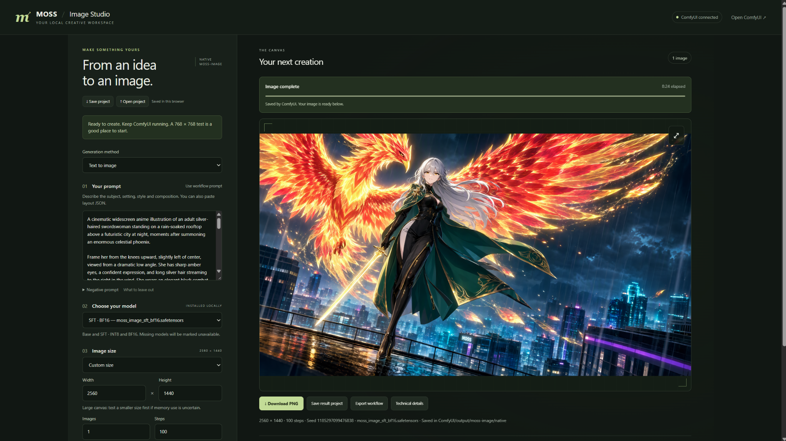

# MOSS Image Studio

**A simple, local browser interface for generating images with MOSS in ComfyUI.**

Write a prompt, choose an installed model, set the image size and steps, and generate. MOSS Image Studio runs inside your existing ComfyUI installation and gives you a dedicated page with previews, downloads and reusable project settings.

*The browser interface in use: adjustable settings on the left, completed image and downloads on the right.*

## Example result

| Detail | Showcase run |
| --- | --- |
| Method | Text to image |
| Diffusion model | MOSS Image SFT BF16 |
| Generation size shown in the interface | 2560 × 1440 |
| Steps | 100 |
| Images | 1 |
| Elapsed time shown in the interface | 8 minutes 24 seconds |
| Shared example PNG dimensions | 2048 × 1152 |

This example was supplied by the project owner after testing the interface. The elapsed time is the Studio timer for that run, including any waiting/loading; it is not a performance benchmark.

**Try the prompt:** [full positive/negative prompts and example notes](examples/phoenix.md). A [Studio starter project](examples/phoenix-starter.json) is included for **Open project**. It uses the same prompt with a smaller 1344 × 768 canvas and 50 steps as a starting point; it is not an exact settings export of the pictured render.

## Features

- **Text to image** with native ComfyUI MOSS nodes.
- **Experimental image to image:** upload a PNG, JPG or WebP, preview a center crop or stretch, adjust the output size and control change strength.
- **Model selection** for installed MOSS Base/SFT and INT8/BF16 variants. Unavailable files are identified.
- **Actual generation controls:** width, height, steps, image count, seed, guidance, sampler and scheduler.
- **Advanced settings:** text encoder, VAE, precision, encoder device, AuraFlow shift, layer guidance and save prefix.
- **Job tracking** with queue status, sampling progress when available, error messages and cancellation scoped to the selected job.
- **Image previews**, a larger view, batch thumbnails and PNG downloads.
- **Save/open projects**, save a result's settings, and export its ComfyUI workflow or technical details.
- **Browser autosave** for everyday settings.

**Version 1.1.0:** tested successfully by the project owner. Image-to-image retains its Experimental label because preservation and editing quality vary with the image and settings. This is an independent community interface, not an official OpenMOSS or Comfy-Org product.

## Before you install

You need a working **local ComfyUI installation**, a core version with native MOSS support, and the MOSS model files you want to use. The interface uses ComfyUI's existing Python environment. There is no separate server to start and no Node.js, npm or additional Python package installation for normal use.

Your ComfyUI installation must allow custom-node add-ons to load. Model files are downloaded separately; they are not included in this repository.

## Install with a ZIP, no commands required

### 1. Download and extract

On this GitHub page, click the green **Code** button, then **Download ZIP**. In Windows File Explorer, right-click the downloaded ZIP and choose **Extract All…**, then **Extract**.

Open the extracted folder until you see `README.md`, `__init__.py`, `workflow.json`, `js` and `web` together. **That entire folder is the add-on.** The filename `__init__.py` has two underscores at the beginning and two before `.py`.

### 2. Find your custom_nodes folder

| Your installation | Where to put the add-on |
| --- | --- |
| Windows Portable | Open `ComfyUI_windows_portable`, then `ComfyUI`, then `custom_nodes`. |
| Manual ComfyUI | Open your ComfyUI installation folder, then `custom_nodes`. |
| ComfyUI Desktop | Find the existing `custom_nodes` directory used by your local Desktop installation/instance. Check its configured installation/data location. Desktop paths vary by version and setup. |

Use the same location as your other custom-node add-ons. The add-on goes in `custom_nodes`, not in `models`.

### 3. Copy it into ComfyUI

1. **Close ComfyUI completely.** For Portable, stop its running command window as well.
2. Rename the extracted add-on folder to **moss_studio**.
3. Copy the whole **moss_studio** folder into your **custom_nodes** folder.
4. Open the copied folder and check that `__init__.py` is directly inside it.

The finished path should end in **`custom_nodes/moss_studio/__init__.py`**. If it ends in `custom_nodes/moss_studio/ComfyUI-MOSS-Studio-main/__init__.py`, there is an extra folder level: move the add-on files up so `__init__.py` is directly inside `moss_studio`.

### 4. Start ComfyUI and open Studio

1. Start ComfyUI normally and wait for it to finish loading. **Leave it running while you use Studio.**
2. Try **Extensions → Open MOSS Studio** in ComfyUI's top menu.
3. Or open the address of your running ComfyUI server and add **`/moss-studio`**.

Examples:

- [http://127.0.0.1:8188/moss-studio](http://127.0.0.1:8188/moss-studio)
- [http://127.0.0.1:8000/moss-studio](http://127.0.0.1:8000/moss-studio), if your installation uses port 8000.

Use your installation's actual host and port. You do not need to load the graph into ComfyUI first; Studio includes its own workflow. Open Studio through ComfyUI, rather than opening `web/index.html` directly from File Explorer.

## Download the models

You need **one diffusion model, one text encoder and one compatible VAE**. If your existing MOSS workflow already works, use those files. Studio detects the filenames reported by ComfyUI, including configured extra model locations.

| Component | Files | Model folder |
| --- | --- | --- |
| MOSS diffusion model, choose one | [SFT INT8](https://huggingface.co/Comfy-Org/MOSS-Image/blob/main/diffusion_models/moss_image_sft_int8_convrot.safetensors), [SFT BF16](https://huggingface.co/Comfy-Org/MOSS-Image/blob/main/diffusion_models/moss_image_sft_bf16.safetensors), [Base INT8](https://huggingface.co/Comfy-Org/MOSS-Image/blob/main/diffusion_models/moss_image_base_int8_convrot.safetensors), [Base BF16](https://huggingface.co/Comfy-Org/MOSS-Image/blob/main/diffusion_models/moss_image_base_bf16.safetensors) | `models/diffusion_models` |
| Text encoder | [qwen3.5_9b_w4a8_gptq.safetensors](https://huggingface.co/Comfy-Org/MOSS-Image/blob/main/text_encoders/qwen3.5_9b_w4a8_gptq.safetensors); [INT8 alternative](https://huggingface.co/Comfy-Org/MOSS-Image/blob/main/text_encoders/qwen3.5_9b_int8_convrot.safetensors) | `models/text_encoders` |
| VAE | [flux2-vae.safetensors](https://huggingface.co/Comfy-Org/MOSS-Image/blob/main/vae/flux2-vae.safetensors), selected by the bundled workflow. A [small VAE](https://huggingface.co/Comfy-Org/MOSS-Image/blob/main/vae/flux2-vae_small.safetensors) is also offered upstream; select its actual filename if you use it. | `models/vae` |

On a Hugging Face file page, use the **download** control. For Desktop, your shared model directory may be elsewhere: use the model paths configured in your installation. Restart ComfyUI after adding files, then use **Check again** in Studio.

The bundled model choice is **SFT BF16**. If you downloaded INT8 instead, select that model in Studio. The encoder and VAE menus are under **Advanced settings**. Installed-component checks do not guarantee a particular render will fit in GPU memory.

## Make your first image

1. Confirm the header says **ComfyUI connected**. Resolve anything listed under **Connection & model checks**.
2. Choose **Text to image** and select an installed MOSS model.
3. Write a prompt, or open [the phoenix starter project](examples/phoenix-starter.json) with **Open project**.
4. For an initial memory test, choose **768 × 768**, **1 image** and **50 steps**.
5. Click **Generate image** once and wait. First-run model loading can take several minutes.
6. Click **Download PNG** when the result appears. ComfyUI also saves the image in its output directory.

**Steps and resolution are editable.** The presets are conveniences; the Width/Height fields set the actual generated size. Use positive multiples of 16, within the limits reported by the installed nodes.

## Experimental image-to-image

Choose **Image to image · Experimental**, upload a source picture, select the output dimensions and inspect the crop/stretch preview. Start with **Change strength 0.55** and compare 0.35 and 0.75 with the same prompt and seed.

This method uses the source image's encoded latent as the starting point for the existing MOSS sampler. It does not require an extra LoRA or community node pack. It redraws the whole image, so faces, text and other details can change. This version does not provide a mask painter or guaranteed character identity preservation.

Project JSON stores the uploaded filename, not the picture itself. Keep the source image and the uploaded copy in ComfyUI's input folder if you want to reproduce the result.

Read [the installation and usage guide](docs/INSTALLATION.md) for the complete controls, and [the research notes](docs/IMAGE_TO_IMAGE_RESEARCH.md) for community editing/control alternatives.

## Updating and troubleshooting

To update a ZIP installation, stop ComfyUI, replace the existing `moss_studio` folder with the new add-on folder, and restart. Keep only one installed copy. Refresh the Studio page; use **Ctrl+F5** on Windows if it still shows the old version. Existing version 1 Studio projects remain compatible.

| Problem | First check |
| --- | --- |
| Studio returns 404 | Confirm the folder placement, fully restart ComfyUI, and use the correct host/port. |
| Open Studio menu is missing | Open `/moss-studio` directly; menu support depends on the ComfyUI frontend. |
| A model or node is unavailable | Read the checks. Confirm model locations and that your running core supports native MOSS. |
| GPU runs out of memory | Reduce output size, use one image, and consider an installed INT8 model. |
| Submission was not confirmed | Inspect ComfyUI's queue before clicking Generate again. The server may have accepted it. |

Closing the Studio tab does not cancel a submitted job. See [the full troubleshooting guide](docs/INSTALLATION.md#troubleshooting).

## Development and sharing

The source is buildless HTML/CSS/JavaScript plus a small Python route module. No frontend build step is required. Tests, GitHub Actions checks, issue templates, release packaging and contribution notes are included.

- [Contributing and developer checks](CONTRIBUTING.md)
- [Validation and the owner-supplied example](docs/VALIDATION.md)
- [How to put this project on GitHub](docs/PUBLISHING.md)
- [Release notes](CHANGELOG.md)

No model weights are included. The source code is provided under the [MIT license](LICENSE); separately installed ComfyUI, model weights and other upstream components keep their own licenses. See [third-party notices](THIRD_PARTY_NOTICES.md).
